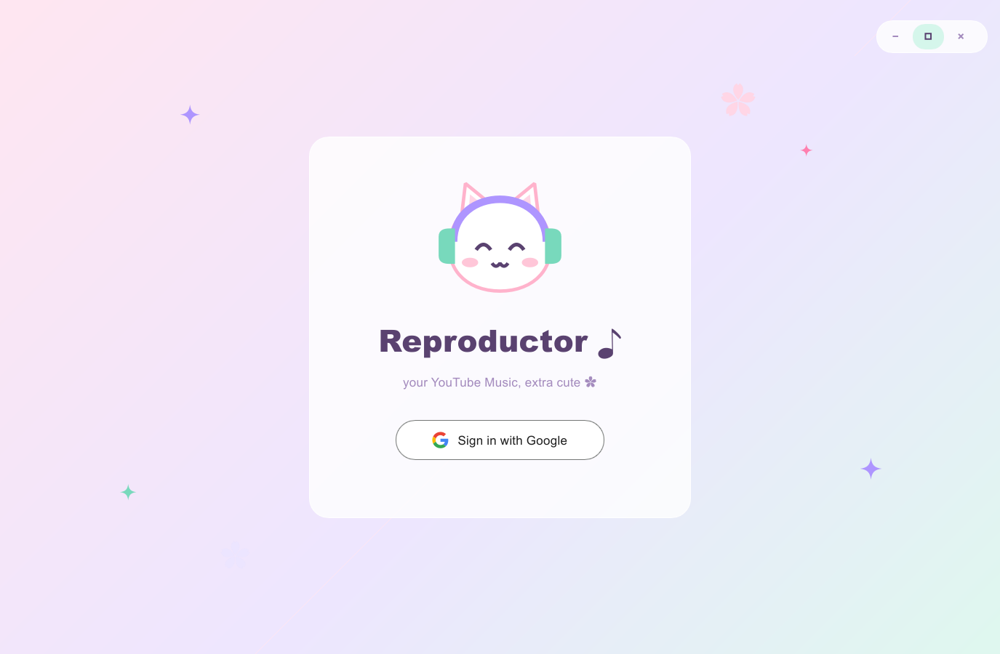

<p align="center">
  
</p>

<h1 align="center">Reproductor ♪</h1>

<p align="center">A tiny, native YouTube Music player for Windows, written in Rust.<br>
Low memory, fast to start a song, and extra cute ✿</p>

<p align="center">
  
</p>

## Features

- **Your YouTube Music library**: account, playlists and *Liked music*, loaded through the same session as the official web app.
- **Fast playback**: an unplayed song typically starts in ~2 s; recently resolved songs in under a second. The next track is downloaded in the background while the current one plays.
- **Light on resources**: ~50 MB of memory and ~4 % of one CPU core while playing, measured on Windows 11 (Slint's CPU renderer, no browser engine during playback).
- **Glitch-free audio**: AAC decoding with symphonia, a lock-free ring buffer to the audio device, shuffle, seek and volume.
- **Kawaii pastel UI**: an original mascot (Mochi), a custom title bar, and motion that only runs while music plays.
- **Self-healing**: when YouTube changes something, the app follows yt-dlp's published fixes automatically (see [How it stays working](#how-it-stays-working)).

## How it works

| Part | What it uses |
|---|---|
| UI | [Slint](https://slint.dev) with its software renderer (`ui/app.slint`) |
| Sign-in | A small WebView2 window (separate short-lived process) captures your YouTube Music session; refreshes are silent unless Google needs you |
| Library | YouTube Music's web API ("InnerTube") with that session |
| Streams | InnerTube player requests (request shapes follow [yt-dlp](https://github.com/yt-dlp/yt-dlp)); YouTube's `n`/signature challenges are solved by yt-dlp's official [EJS](https://github.com/yt-dlp/ejs) scripts running in an embedded [QuickJS-ng](https://github.com/quickjs-ng/quickjs) engine |
| Fallback | [yt-dlp](https://github.com/yt-dlp/yt-dlp) itself, if the fast path fails |
| Audio | [symphonia](https://github.com/pdeljanov/Symphonia) (AAC/MP4) → [rtrb](https://github.com/mgeier/rtrb) → [cpal](https://github.com/RustAudio/cpal) |

### How it stays working

YouTube changes its internals often. Reproductor keeps up without new releases:

- **Client identifiers** (names, versions, user agents) are read from yt-dlp's latest release.
- **Challenge-solver scripts** are downloaded from yt-dlp/ejs and accepted only if their SHA3-512 matches the hashes yt-dlp pins for that release.
- **yt-dlp** (the fallback) updates itself daily; the archive is checked against yt-dlp's `SHA2-256SUMS`.
- **A remote config** ([`config/default.json`](config/default.json), published as a gist) chooses which clients to use and in what order. Hosts are restricted to `www.youtube.com` / `music.youtube.com`, so a bad config can't send your session anywhere else.

## Requirements

- Windows 10 or 11 (64-bit), with the [WebView2 runtime](https://developer.microsoft.com/microsoft-edge/webview2/) (preinstalled on Windows 11)
- [Rust](https://rustup.rs) (stable, MSVC toolchain) and the Visual Studio Build Tools with the **Windows SDK**
- A YouTube / YouTube Music account

## Build and run

```powershell
cargo run                    # day-to-day: ~6 s incremental builds
cargo build --release        # the fast, small exe: target\release\reproductor.exe
```

The first build compiles all dependencies (optimized, even in debug builds) and takes a while; after that, changes rebuild in seconds. On first launch, click **Sign in with Google** and sign in to YouTube Music in the window that opens.

Developer helpers:

```powershell
.\scripts\ui-dev.ps1 [-Playing] [-SignIn]   # UI hot reload: edit ui/app.slint, the window updates on save
cargo run --example make_icon               # regenerate assets/icon.ico + icon-256.png from assets/logo.svg
cargo test                                  # unit + live tests (some need a signed-in session)
```

Build notes for low-memory machines: `.cargo/config.toml` limits Cargo to 2 parallel jobs and uses Rust's bundled `rust-lld` linker.

## Where your data lives

| File | What |
|---|---|
| `%APPDATA%\reproductor-rs\cookies.txt` | Your YouTube session. **Treat it like a password.** |
| `%LOCALAPPDATA%\reproductor-rs\webview\` | The sign-in window's profile (lets refreshes be silent) |
| `%LOCALAPPDATA%\reproductor-rs\` | Caches: resolved stream URLs, YouTube's preprocessed player, solver scripts, yt-dlp, remote config |
| `%APPDATA%\reproductor-rs\config.json` | Optional local override of the remote config |

**Sign out** in the app deletes the session and the sign-in profile. Nothing is sent anywhere except YouTube/Google, GitHub (updates and config) and the gist above.

## Disclaimer

Reproductor is an unofficial, personal project. It is **not affiliated with, endorsed by, or connected to YouTube or Google**. It uses YouTube's internal APIs with your own session, which is against YouTube's Terms of Service. YouTube may block it or restrict the account used, so consider using a secondary account. It streams for personal listening only and does not save or redistribute media. Use at your own risk.

## Credits

- [yt-dlp](https://github.com/yt-dlp/yt-dlp) and [yt-dlp/ejs](https://github.com/yt-dlp/ejs): request shapes, client data and the challenge solver this app relies on
- [Metrolist](https://github.com/MetrolistGroup/Metrolist) / [innertubex](https://github.com/MetrolistGroup/innertubex): inspiration for client fallback and remote configuration
- Built with [Slint](https://slint.dev), [symphonia](https://github.com/pdeljanov/Symphonia), [cpal](https://github.com/RustAudio/cpal), [rquickjs](https://github.com/DelSkayn/rquickjs), [wry](https://github.com/tauri-apps/wry), [ureq](https://github.com/algesten/ureq) and [resvg](https://github.com/linebender/resvg)
- Mochi and the logo are original artwork for this project

<a href="https://slint.dev"></a>

Slint is used under the [Slint Royalty-free Desktop, Mobile, and Web Applications License](https://github.com/slint-ui/slint/blob/master/LICENSES/LicenseRef-Slint-Royalty-free-2.0.md), which asks for the badge above.

## License

Licensed under either of [Apache License, Version 2.0](LICENSE-APACHE) or [MIT license](LICENSE-MIT), at your option.

Unless you explicitly state otherwise, any contribution intentionally submitted for inclusion in this project by you, as defined in the Apache-2.0 license, shall be dual licensed as above, without any additional terms or conditions.
